# System Architecture & Technical Specifications

**Aplikasi**: Portal Kuesioner & Survei SHARING VISION™  
**Versi**: 1.2.0  
**Lingkungan**: Next.js 16.4.0 (Turbopack) / React 19.3.0  
**Basis Data**: Google Cloud Firestore & Firebase Authentication  

---

## 1. Tech Stack Overview

| Layer | Teknologi | Keterangan & Rationale |
| :--- | :--- | :--- |
| **Framework** | Next.js 16.4 (App Router) | Menggunakan Turbopack, Server Actions, Partial Prerendering, dan `await connection()` untuk rute dinamis. |
| **Runtime & Language** | Node.js (v20+) & TypeScript 5 | Tipe data kuat (*strict type-safety*) di seluruh lapisan client dan server. |
| **Styling & Theming** | Tailwind CSS v4 & `next-themes` | Bento Box design system, Corporate Red `#DF1A3D`, serta tema Light, Dark, dan System. |
| **Client Database & Auth** | Firebase Client SDK v13.0 | Untuk proses login admin dan pengiriman respon publik (`addDoc`). |
| **Server Administration** | Firebase Admin SDK | Menangani operasi pengguna (`listUsers`, `createUser`, `updateUser`, `deleteUser`) dan penulisan audit log dengan hak istimewa server. |
| **Skema & Validasi** | Zod v3 | Validasi ketat payload kuesioner, respon jawaban, dan akun admin. |
| **Visualisasi Data** | Recharts v3 | Diagram pie, bar vertikal/horizontal, dan analitik interaktif. |

---

## 2. Diagram Topologi Arsitektur

```mermaid
graph TD
    subgraph ClientLayer ["Client & Public Layer"]
        A["Responden Publik (/form/:id)"]
        B["Admin Browser (/admin/*)"]
    end

    subgraph NextServer ["Next.js 16 Server Layer"]
        M["Middleware (src/middleware.ts)\nVerifikasi Cookie pb_auth"]
        
        subgraph ServerActions ["Server Actions & Routes"]
            SA_Auth["src/actions/auth.ts\n(loginAdminAction, logoutAdminAction)"]
            SA_Users["src/actions/users.ts\n(listUsers, createUser, deleteUser)"]
            SA_Forms["src/actions/forms.ts\n(createForm, updateForm, deleteForm)"]
            SA_Audit["src/actions/audit.ts\n(fetchAuditLogs, recordAudit)"]
            API_Users["src/app/api/admin/users/route.ts"]
            API_Forms["src/app/api/forms/route.ts"]
        end

        subgraph CoreServices ["Core Services & Admin SDK"]
            AdminSDK["src/lib/firebase-admin.ts\n(Lazy Proxy adminAuth & adminDb)"]
            AuditService["src/services/audit.service.ts\n(logActivity non-blocking)"]
            FormsService["src/services/forms.service.ts"]
            ResponsesService["src/services/responses.service.ts"]
        end
    end

    subgraph FirebaseCloud ["Google Cloud / Firebase Platform"]
        F_Auth["Firebase Authentication\n(Akun & Password Admin)"]
        F_Store["Cloud Firestore\n- forms\n- responses\n- audit_logs\n- admins/users"]
    end

    A -->|"Submit Jawaban"| SA_Forms
    B --> M
    M -->|"Authorized"| ServerActions
    SA_Users --> AdminSDK
    SA_Forms --> FormsService
    SA_Forms -.->|"Non-blocking background log"| AuditService
    SA_Users -.->|"Audit Trail"| AuditService
    AuditService --> AdminSDK
    AdminSDK --> F_Auth
    AdminSDK --> F_Store
    FormsService --> F_Store
    ResponsesService --> F_Store
```



---

## 3. Struktur Direktori Proyek

```text
svi-kuesioner/
├── public/
│   ├── Logo-Sharingvision-Main.png     # Logo resmi Sharing Vision (PNG resolusi tinggi)
│   ├── icon.png                        # Custom favicon & app icon
│   └── sharing-vision-consultant...    # Icon aset pendukung
├── src/
│   ├── actions/                        # Next.js Server Actions (Mutasi aman sisi server)
│   │   ├── audit.ts                    # Server action penarikan log audit
│   │   ├── auth.ts                     # Login & logout admin dengan HTTP-only cookie
│   │   ├── forms.ts                    # CRUD kuesioner dengan audit logging terintegrasi
│   │   ├── responses.ts                # Pengelolaan tanggapan kuesioner
│   │   └── users.ts                    # CRUD pengguna menggunakan Firebase Admin SDK
│   ├── app/
│   │   ├── admin/                      # Area terproteksi Portal Admin
│   │   │   ├── audit-logs/             # Halaman Audit Trail & Log Aktivitas
│   │   │   ├── dashboard/              # Bento Box diagram & metrik analitik
│   │   │   ├── kuesioner/              # Dynamic Questionnaire Builder
│   │   │   ├── login/                  # Halaman otentikasi admin
│   │   │   ├── report/                 # Tabel Master Rekap Data & Export CSV
│   │   │   ├── responses/              # Tabel jawaban teks responden
│   │   │   ├── users/                  # Halaman User Management Admin
│   │   │   └── layout.tsx              # Admin Shell Loader dengan Suspense
│   │   ├── api/                        # REST API Endpoints
│   │   │   ├── admin/users/            # API Route CRUD User
│   │   │   ├── forms/                  # API Route CRUD Form & publikasi
│   │   │   └── responses/              # API Route submit respon
│   │   ├── form/[formId]/              # Public dynamic form submission page
│   │   ├── globals.css                 # Token Tailwind CSS v4 & styling global
│   │   ├── layout.tsx                  # Root layout dengan ThemeProvider & Font Inter
│   │   └── page.tsx                    # Landing page portal kuesioner
│   ├── components/                     # Komponen antarmuka (Bento Box architecture)
│   │   ├── AdminHeader.tsx             # Header bar & dropdown pemilih form aktif
│   │   ├── AdminSidebar.tsx            # Sidebar dua grup (MENU UTAMA & ADMINISTRATOR)
│   │   ├── AuditLogsView.tsx           # Dual-view log viewer (Timeline & Tabel)
│   │   ├── UserManagementView.tsx      # Tabel user, modal CRUD, & kartu metrik
│   │   └── ...                         # Komponen form builder, chart, dsb.
│   ├── lib/
│   │   ├── date.ts                     # Formatter tanggal lokal Bahasa Indonesia (id-ID)
│   │   ├── firebase.ts                 # Firebase Client SDK singleton & error handler
│   │   └── firebase-admin.ts           # Firebase Admin SDK initialization via Lazy Proxy
│   ├── services/                       # Business logic & Firestore communication
│   │   ├── audit.service.ts            # Layanan perekaman & pembacaan audit trail
│   │   ├── forms.service.ts            # Service kuesioner & kalkulasi analitik
│   │   └── responses.service.ts        # Service agregasi jawaban responden
│   ├── types/                          # TypeScript Interfaces & Types
│   │   ├── audit.ts                    # AuditLogRecord & LogActivityParams
│   │   ├── form.ts                     # FormRecord & Question schemas
│   │   ├── response.ts                 # FormAnalytics & RespondentAnswer
│   │   └── user.ts                     # AdminUserRecord & Input types
│   └── middleware.ts                   # Perlindungan rute /admin dengan verifikasi sesi
```

---

## 4. Skema Basis Data (Firestore Collections)

### 4.1. Koleksi `forms` (Kuesioner)
Menyimpan spesifikasi kuesioner survei dinamis:
```typescript
interface FormDocument {
  title: string;              // Judul kuesioner
  description: string;        // Petunjuk pengisian kuesioner
  is_active: boolean;         // Status publikasi form (true = buka, false = tutup)
  created: string;            // ISO Timestamp pembuatan form
  updated: string;            // ISO Timestamp modifikasi terakhir
  questions: Array<{
    id: string;               // ID unik pertanyaan (misal: "q_1", "q_2")
    label: string;            // Teks pertanyaan
    type: 'text' | 'textarea' | 'radio' | 'checkbox' | 'dropdown';
    required: boolean;        // Wajib diisi atau tidak
    options?: string[];       // Pilihan jawaban (khusus radio, checkbox, dropdown)
  }>;
}
```

### 4.2. Koleksi `responses` (Jawaban Responden)
Menampung pengiriman jawaban survei dari responden:
```typescript
interface ResponseDocument {
  form_id: string;            // Foreign key merujuk ke forms.id
  respondent_name: string;    // Nama responden (atau Anonymous)
  submitted_at: string;       // ISO Timestamp pengisian
  answers: {
    [questionId: string]: string | string[]; // Pemetaan ID pertanyaan ke jawaban
  };
}
```

### 4.3. Koleksi `audit_logs` (Audit Trail)
Mencatat seluruh rekam jejak aktivitas kritis administrator:
```typescript
interface AuditLogDocument {
  action: 'CREATE_USER' | 'UPDATE_USER' | 'DELETE_USER' | 'CREATE_FORM' | 'UPDATE_FORM' | 'DELETE_FORM' | 'CHANGE_FORM_STATUS' | string;
  performedBy: string;        // Email atau UID admin yang melakukan tindakan
  details: string;            // Deskripsi aktivitas (misal: 'Created new form: Survei IT 2026')
  timestamp: string;          // ISO Timestamp untuk pengurutan dan visualisasi
  created_at: string;         // Fallback ISO timestamp
}
```

---

## 5. Keamanan & Pola Eksekusi Backend

1. **Pemisahan Hak Client vs Server (Admin SDK Isolation)**:
   - Client SDK hanya digunakan untuk alur otentikasi browser standar dan pembacaan form publik.
   - Operasi manajerial (pembuatan/penghapusan admin di Firebase Authentication) diproses secara terisolasi di sisi server via `firebase-admin/auth`. Kredensial *Service Account* dilindungi dalam environment variable privat (`FIREBASE_CLIENT_EMAIL`, `FIREBASE_PRIVATE_KEY`) yang tidak pernah diekspos ke browser.
2. **Lazy Runtime Proxy Pattern**:
   - Inisialisasi Firebase Admin di [`src/lib/firebase-admin.ts`](file:///home/sayoga/projects/svi-kuesioner/src/lib/firebase-admin.ts) menggunakan Proxy dinamis. Hal ini memastikan pemanggilan SDK dilakukan saat variabel `.env.local` telah 100% termuat di memori, mencegah kegagalan *Cold Start* atau *Hot Reload* pada Turbopack.
3. **Perekaman Audit Trail Non-Blocking**:
   - Pemanggilan `logActivity` pada mutasi kuesioner menggunakan pola `void logActivity(...).catch(...)`. Server Actions mengembalikan status sukses secara instan ke UI sementara proses penulisan ke Firestore `audit_logs` diselesaikan secara asinkron di latar belakang.
4. **Proteksi Sesi Admin (HTTP-Only Cookies)**:
   - Sesi admin disimpan dalam cookie terenkripsi `pb_auth` (`httpOnly: true`, `sameSite: 'lax'`, `secure: process.env.NODE_ENV === 'production'`).
   - Rute `/admin/*` diverifikasi pada tingkat Next.js Middleware sebelum komponen halaman dirender.